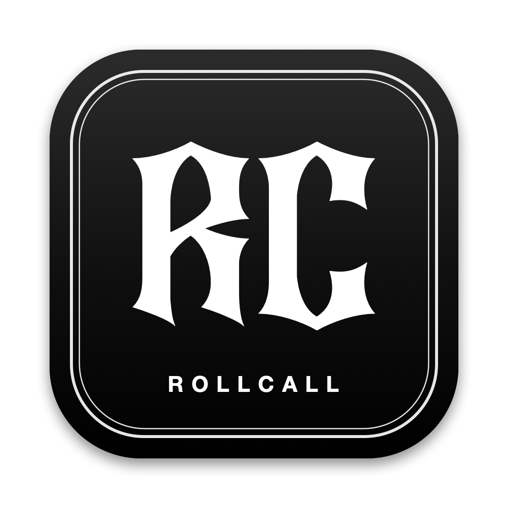

# RollCall



RollCall is a Mac menu bar app that finds motorbike group rides and events near you, from clubs,
forums, event sites, Meetup and your group chats. Pick **Going** and the ride goes into your calendar.

Everything stays on your Mac. RollCall never posts, sends messages or RSVPs for you.

## Install

Needs macOS 14 or newer (Apple silicon or Intel).

1. Download **RollCall.dmg** from the [latest release](https://github.com/MadisonDayerson/RollCall/releases/latest).
2. Open it and drag **RollCall** into **Applications**.
3. Open RollCall. The first time, your Mac blocks it because it isn't from the App Store:
   go to **System Settings → Privacy & Security**, click **Open Anyway**, and enter your password.

Setup asks for each permission once, at the step that needs it: your calendar, and notifications for plans
found in chats. RollCall updates itself (choose **Update now**
in the menu) and keeps those permissions over updates.

## Set up

A setup guide opens the first time (re-open it any time with **Set up RollCall…** in the menu):

1. **Your area:** your suburb or town, and how far you'll travel.
2. **Chats:** connect group chats through the free [Beeper](https://www.beeper.com/download) app
   (see [Group chats](#group-chats)).
3. **Groups & accounts:** pick from suggestions for your area, or paste any link or `@instagram` name.
4. **Calendar:** allow access, then choose iCloud, Google, Exchange or this Mac.
   For Google, first add your Google account in **System Settings → Internet Accounts**.
5. **Riding together:** your crew's location app, voice chat, Discord and tags
   (see [Riding with friends](#riding-with-friends)).

## Everyday use

Click **RC** in the menu bar to see upcoming rides and mark them **Going**, **Maybe** or **Skip**.
Going adds the ride to your **RollCall** calendar, with a reminder the evening before.

The full window opens when you open RollCall (or choose **Open RollCall…** in the menu). While it's open,
RollCall has its own menus at the top of the screen, and ⌘1–⌘4 switch pages:

- **Rides:** a ride posted in several places (say, Facebook and a forum) shows once, with every place under
  **From**. **All** shows Undecided (including Maybe), Going, Skipped and Past in sections you can fold away. Click a
  ride for a plain summary of the description (**See more** shows all of it), the event page (to RSVP) and
  the route. Choose **Going**, **Maybe** or **Skip** at the top of its page; nothing is chosen while it's undecided,
  and choosing the chosen one again leaves it undecided. A ? on the date means it was read from a post, so double-check it.
  Rides you went on move to **Past** once they're over, and are deleted after a week (up to two: Settings → Privacy).
- **To review:** ride plans from your chats, in two groups. **Possible plans** meet every test: a ride or bike
  event on a day still to come, with a time and a place. **Partial plans** are still missing one of those, along
  with ride posts that didn't say when. RollCall keeps reading each conversation as the details are settled, until
  the ride is over (or for four days while there's no day yet, and never past two weeks of quiet): a partial plan moves up (with a notification) once
  it's complete, and a ride added from a plan takes a new time or place, whether you're going or not. After a quiet spell,
  only a message giving the plan's day, a time or a meeting place picks the conversation up again. Plans you mark
  **Not a ride** wait under **Reviewed** for a week, in case you change your mind.
- **Sources:** everything RollCall reads, grouped by app (click a heading to fold it away). Chats are
  checked every 15 minutes, calendars every 3 hours, and websites and forums every 6 hours; change
  any of them with **Check for new rides** (right-click a heading to change a whole group).
  Instagram and Facebook you check yourself. Add a source with **+** in the toolbar; change its name or link on its page (a new
  link is read straight away); remove it with the Delete key, **Remove…** on its page or by right-clicking it.
- **Settings:** home area, chats, your Facebook events link, calendar, riding together, road alerts and updates.

## Adding rides and sources

Click **+** in the toolbar and choose **Add a Ride…** or **Add a Source…**.

**Add a Source…**: paste a link and RollCall works out what it is, then keeps checking it for new rides.

| Paste | Result |
|---|---|
| Club or event website, forum section, Meetup group, calendar link (`.ics`, `webcal://`) or news feed | Checked automatically |
| Your Facebook events calendar link | Follow the steps below |
| Instagram account (`@name`) | Added to the accounts you check |

Chats are added here too, with **Check chats** (see Group chats below).

**Add a Ride…** adds one ride:
- **Paste an event poster**: copy the poster's picture (right-click it → Copy Image, or ⌃⇧⌘4 for a screenshot
  of it) and RollCall reads its words on your Mac, then fills in the name, date, time and meeting place for
  you to check. With nothing copied, you choose the picture file instead. Apple Intelligence, when it's on,
  helps make sense of the poster; nothing leaves your Mac.
- **Paste a post or message**: the text of a post or message, or an Instagram post's link.
- **Type a ride in**, **Import a calendar file** or **Add a Facebook event**.

**Your Facebook events.** Facebook can share a private calendar of the events you're Going or Interested
in. Connect it in setup's **Groups & accounts** step, in **Settings → Facebook** (where you can also replace
or disconnect it), or under **Sources → Facebook events**:
1. Click **Open Facebook Events**, find **Add to calendar**, right-click it and choose **Copy Link**.
2. Paste the link into RollCall and click **Connect**. Bike events you respond to then come in by themselves.

Your reply comes with them: Going on Facebook makes the ride Going in RollCall (and adds it to your calendar),
and Interested makes it Maybe. If you change your reply on Facebook, RollCall follows, unless you've chosen
something else for that ride in RollCall yourself, which always wins.

Keep that link to yourself: anyone who has it can see your events.

**One Facebook event at a time** (events you haven't responded to, or if the calendar link stops working):
1. Click **+** → **Add a Ride…** → **Add a Facebook event**, paste the event link, then click **Open event page**.
2. On Facebook, click **⋯** → **Add to calendar** → **Download**.
3. The ride appears in RollCall within a minute. (Allow access to Downloads if asked.)

**Instagram posts.** Instagram doesn't let apps read posts, so open the account from **Sources**,
copy a ride post's caption (⌘C), then click **+** → **Add a Ride…** → **Paste a post or message**. RollCall fills in
the date, time and place for you to check.

## Group chats

WhatsApp, Messenger and Messages don't let other apps read chats. [Beeper](https://www.beeper.com/download)
brings them into one app and lets RollCall read only the chats you choose, read-only.

New to Beeper? In setup's **Chats** step, click **Set up Beeper**. RollCall walks you
through each step below in plain language and checks each one for you.

1. Install Beeper and connect your chat accounts in **Beeper → Settings → Accounts**.
2. In Beeper, open **Settings → Developers** and switch on **Beeper Desktop API**.
3. In RollCall, click **+** → **Add a Source…** → **Check chats**, click **Allow** in Beeper, then tick your ride chats.

When a chat mentions a day or time for a ride or bike event, RollCall sums up the plan (what, when,
where, who's in) and asks you to review it. Replies that settle the details later join the same plan, and a ride
you added from a plan takes its new time or place if the chat changes it (your own edits stay). Rides are named after where they start and end when the chat says,
like "Yarra Glen to Sugarloaf Reservoir". A message sent to several of your chats shows once. **Add ride…** has Apple Intelligence read the conversation and fill in the name, start, length, meeting place, link and notes (destination and stops) for you to check. Summaries use
Apple Intelligence on your Mac where available. Beeper needs to be open for chats to be checked.

## Riding with friends

Each ride's page starts with its status, then **About**: when, where, who it's from and a plain summary of the
description. The **⋯** button on each ride in the list (it shows when you point at the ride or choose it), or a right-click on the ride, has the same actions for every ride: **Open** (the event page, or
the post or message it came from), **Open route in**, **Edit…** and **Remove** (one that can't do anything yet is
greyed out and says why). **Remove** takes the ride away for good, even if its source still lists it. **Edit…** changes the name, time, length, place,
link or notes; your changes stay when RollCall checks the source again, and go to the calendar for rides you're going to.
**Refresh** (the ↻ button, or Refresh Now) checks every source, then (with Apple Intelligence on) looks for more about
the rides you're going to or might go to, and the plans in **To review** that have a day: through each one's event
page, the last two weeks of your chats, and your other sources' listings and posts. The automatic checks every few
minutes don't do this. Apple's on-device model reads each find
and keeps it only if it's about this very ride (the same event on the same day, not another week's or a similar ride
nearby), then shows what the ride doesn't say yet: its time, meeting place, destination, stops, cost or link, with
where each came from, under **More details** on its page. While it looks, a small spinner shows next to that ride in
the list (point at it to see what it's checking), and the **Roll Call** at the foot of the sidebar glows. Click **Add** for the ones you want; they're saved like an
edit. For a plan in **To review**, what it finds fills in the **Add ride…** form, apart from any you **Leave out**. **Open route in** gives directions from your suburb through the meeting place and stops in the
maps app you pick: Apple Maps, Google Maps, Waze or Kurviger (Apple Maps and Waze only take the meeting place). When the
description has the organiser's own route, it's at the top of the list. Each ride's page also shows a map of the road
route with the distance and riding time; click it to open the route in the maps app chosen in Settings. When the organiser shared a Google Maps or Apple Maps route (a short
maps.app.goo.gl link too), the map follows it exactly, ahead of any places written in the post. Otherwise RollCall works out the start, stops and destination from the ride's title
and description (with Apple Intelligence on the Mac when the wording isn't plain), checks each place with Apple Maps,
and leaves out ones it can't find. A ride at one place, like a track day or bike night, shows the trip there from
your suburb. Under the map is the weather along the way: the temperature, chance of rain and wind at points every
40 to 50 km, for when you'd reach each one. Likely rain and strong gusts are in orange. Rides more than a week away
say when their forecast will be ready. Below that are **road alerts** in Victoria: crashes, closures, hazards and
roadworks on the roads you'd ride, at the time you'd be riding them, one line per road with closures first (in
orange). They're marked on the map too, beside the route on little stalks: hold the pointer over an icon for a brief summary
of it, written on your Mac by Apple Intelligence when it's on. The list itself is under **Road alerts on N roads**: click it to open. Alerts happening now show for rides within a day; booked roadworks take about a minute to download the
first time, then show straight away (RollCall keeps them on your Mac and fetches new ones in the background every
six hours). They need a free key of your own (see **Road alerts** below).

**Road alerts.** The alerts come from the Department of Transport and Planning's open data. To turn them on:
1. Go to the [Transport Victoria Open Data Portal](https://opendata.transport.vic.gov.au/), click **Login**, then
   **Sign up**. Enter your details, then the code they email you.
2. The portal asks you to set up an authenticator app on your phone (any one works, such as Google Authenticator
   or Microsoft Authenticator): scan the QR code and enter the code it shows.
3. Log in, click **My Account → Profile**, then **API tokens**, and copy your key.
4. In RollCall, paste it into **Settings → Road alerts** and click **Save**.

**Road alerts on routes**, in the same place, chooses what routes show: **Current and planned** (the usual),
**Current only** (no booked roadworks, which then aren't downloaded) or **None**. Choosing either of the last two deletes
any booked roadworks already downloaded. It's greyed out until a key is saved.

The calendar event for a ride you're going to includes the map link, your crew's Discord, voice chat group and a
location-sharing reminder.

**Voice chat** (Settings → Riding together) is your helmet intercom (Cardo, Sena, Interphone, UClear, Midland,
FreedConn, LEXIN) or a call (Discord voice, WhatsApp). Intercoms pair with your phone, not your Mac, so set up
the group in its phone app and add the group or channel name: calendar events then say which to join.

Every ride gets a code tag of #RC and the date, like `#RC03112026`, the same for everyone using RollCall.
Tags for the club, brand, place or occasion follow it (`#Hooligoon #TTR #Broadford #Halloween`). They're in the
calendar event, so everyone tags their photos and videos the same way.

Life360, Cardo and the social apps don't let other apps connect, so RollCall puts the details and
tags in the calendar event rather than showing friends' locations or posting for you.

## Your privacy

- **No accounts, no tracking, no AI services.** RollCall has no server of its own. It doesn't collect or
  send anything about you, and nobody else using RollCall can see your rides, chats or settings.
- **Chats stay on your Mac.** They're read through Beeper Desktop on your own Mac, with read-only permission.
  Only the last two weeks of messages are read (older chat is no longer relevant), and after the first time
  just the messages since the last check; forums and news feeds are read back two weeks too. The Beeper key is kept in your keychain. Chat plans are summarised by Apple's on-device model (when Apple
  Intelligence is on), so messages never go to an online AI. The same on-device model reads ride descriptions to
  find their start, stops and destination. Before the model reads them, swearing is left out, tracking is taken off links and long
  conversations are trimmed to the messages that matter; your messages themselves aren't changed.
- **Saved rides are private.** They're in `~/Library/Application Support/RollCall`, which only your Mac
  account can open. RollCall keeps no web cache or cookies.
- **Only what's needed is kept.** Your home area is saved as just the suburb and a rough spot (about 1 km).
  Past rides, and the messages from plans you mark Not a ride, are deleted after a week (or straight away, or
  after a day or two weeks at most: choose in Settings → Privacy). Calendar events stay in Calendar. Posts and
  conversations waiting to be looked at go after two weeks, and places are only remembered for rides RollCall
  still has. Removing a chat removes what was kept from it.
- **You're in control.** Settings → Privacy → **Delete all data** removes everything RollCall kept
  on your Mac and disconnects Beeper.
- **What goes online.** RollCall only downloads the pages and calendars on your Sources list, with no cookies
  or details about you, and follows a short Google Maps link (maps.app.goo.gl) in a ride's description once to
  find the route it points to. **Refresh** downloads the event pages of the rides it looks for more details about (never Facebook or
  Instagram). It asks Apple Maps where a ride's location is, so it can work out the distance (a match more than 1000 km
  away is taken as not found, since it's another place with the same name), and
  plans the road route between a ride's places to draw its map. For the weather along a route, the positions of
  a few points on it (not the ride or anything about you) go to Open-Meteo, a free forecast service. With a road
  alerts key, RollCall downloads all of Victoria's road alerts from the Department of Transport and Planning (your
  key is kept in your keychain) and matches them to the route on your Mac, so the route isn't sent. Booked roadworks
  are kept on your Mac between downloads; they're public road data, nothing about you. And
  it checks this project's GitHub page for updates. An update is only installed if it comes from those
  releases and its seal shows it hasn't been changed. When you open a ride's route, your suburb
  (never your street) and the ride's stops go to your maps app (Apple Maps, Google Maps, Waze or Kurviger) to plan the route.
- **Sharing with your iPhone and iPad** (only if you turn it on). Your rides, choices, ride changes and sources
  (including private calendar links) go to a RollCall folder in your own iCloud Drive, where RollCall on your
  iPhone and iPad reads them. Chat messages don't: rides from chats are shared without them.
- **What you share.** Rides you're going to are added to the RollCall calendar, in the calendar account you
  choose. Text from chat messages isn't added, except a detail Refresh found that you add yourself.

RollCall is made to follow the Australian Privacy Principles: it only collects what it needs, keeps it
secure, and deletes it when it's no longer needed. To report a security problem, see [SECURITY.md](SECURITY.md).

## For developers

```bash
./build.sh --install                     # build, install in ~/Applications and open
./build.sh --share                       # build/RollCall.dmg for Apple silicon and Intel
./release.sh 1.1 "What's new"            # test, build, tag, push and publish a GitHub release
```

Run the tests:

```bash
./test.sh
```

- The code is in three folders: `Sources/Shared` (used by both apps: reading sources, rides, routes, calendar,
  sync), `Sources/Mac` (the Mac app's windows and menus) and `iOS/RollCall` (the iPhone and iPad screens).
  `./test.sh` also checks the iPhone app still builds, and `release.sh` gives both apps the same version number.
- Data is saved in `~/Library/Application Support/RollCall/state.json`; the Beeper token is in your
  login keychain.
- `--snapshots <folder>` saves a picture of every page; `--check-chats` shows how chat messages are read;
  `--check-details` shows what Refresh's search for more details finds.
- The logo is drawn by `Design/make_icon.swift` (see `Design/fonts/bosieh/ABOUT.txt` for the font).
- The app isn't signed with an Apple Developer ID, which is why the first open needs **Open Anyway**.
  Releases are signed with RollCall's own certificate instead (run `./make_signing_key.sh` once on the Mac
  that makes releases; `release.sh` won't run without it), so macOS treats every update as the same app and
  doesn't ask for keychain, calendar or Downloads access again. Without it, `build.sh` signs ad-hoc.

## iPhone and iPad (in progress)

`iOS/RollCall.xcodeproj` is a first iPhone and iPad version. It reads the same clubs, calendars, forums and
event sites by itself (group chats stay on the Mac) and puts rides you're going to in a RollCall calendar.

**Sharing with the Mac.** On the Mac, turn on Settings → iPhone and iPad → **Share with RollCall on iPhone and
iPad** (iCloud Drive needs to be on). That makes a RollCall folder in iCloud Drive. On the iPhone, tap Settings →
**Share with RollCall on Mac…** and choose that folder. From then on, rides, Going/Maybe/Skip choices, ride
changes and sources go both ways: each device keeps its own file in the folder and reads the others', and the
later change wins. Rides from your group chats reach the iPhone without the messages they came from. Rides you're
going to are added to the RollCall calendar once, even when both devices add them.

To put it on your own iPhone or iPad with a free Apple account:

1. Open `iOS/RollCall.xcodeproj` in Xcode.
2. Xcode → Settings → Apple Accounts → **+** → Apple Account, and sign in with your Apple ID.
3. Click the blue RollCall project at the top of the file list, choose the **RollCall** target, then
   **Signing & Capabilities**. Leave "Automatically manage signing" on and choose your name (Personal Team)
   under Team.
4. Plug the iPhone in with a cable, unlock it and tap **Trust** if it asks.
5. On the iPhone: Settings → Privacy & Security → **Developer Mode** → on, then restart it when asked.
6. In Xcode, choose the iPhone from the device menu at the top of the window and press ▶ (Run).
7. The first time, the iPhone says the developer isn't trusted: Settings → General → VPN & Device Management →
   your Apple ID → **Trust**. Then open RollCall.

With a free account the app stops opening after 7 days: plug in and press ▶ again to renew it.
