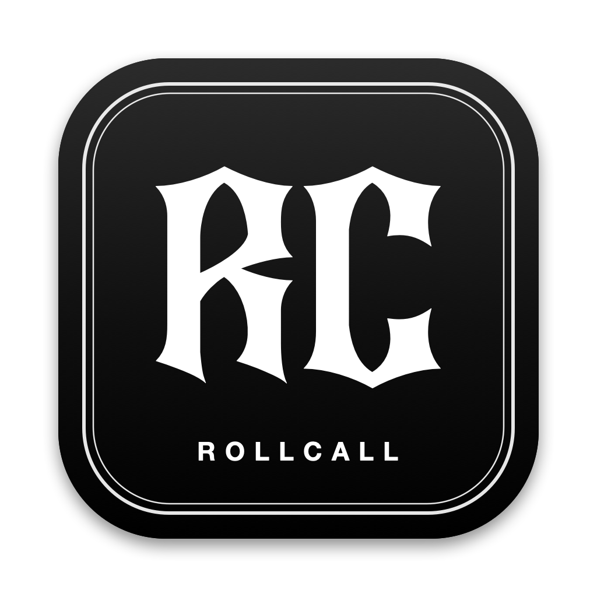

# RollCall



RollCall is a Mac menu bar app that finds motorbike group rides and events near you, from clubs,
forums, event sites, Meetup and your group chats. Pick **Attending** and the ride goes into your calendar.

Everything stays on your Mac. RollCall never posts, sends messages or RSVPs for you.

## Install

Needs macOS 14 or newer (Apple silicon or Intel).

1. Download **RollCall.dmg** from the [latest release](https://github.com/MadisonDayerson/RollCall/releases/latest).
2. Open it and drag **RollCall** into **Applications**.
3. Open RollCall. The first time, your Mac blocks it because it isn't from the App Store:
   go to **System Settings → Privacy & Security**, click **Open Anyway**, and enter your password.

RollCall updates itself: when a new version is out, choose **Update now** in the menu.

## Set up

A setup guide opens the first time (re-open it any time with **Set up RollCall…** in the menu):

1. **Your area:** your suburb or town, and how far you'll travel.
2. **Chats:** connect group chats through the free [Beeper](https://www.beeper.com/download) app
   (see [Group chats](#group-chats)).
3. **Groups & accounts:** pick from suggestions for your area, or paste any link or `@instagram` name.
4. **Calendar:** allow access, then choose iCloud, Google, Exchange or this Mac.
   For Google, first add your Google account in **System Settings → Internet Accounts**.
5. **Riding together:** your crew's location app, intercom, Discord and tags
   (see [Riding with friends](#riding-with-friends)).

## Everyday use

Click **RC** in the menu bar to see upcoming rides and mark them **Attending**, **Maybe** or **Skip**.
Attending adds the ride to your **RollCall** calendar, with a reminder the evening before.

Choose **Open RollCall…** (⌘O) for the full window:

- **Rides:** every upcoming ride. Click one for details, the event page (to RSVP), the group page
  (to join) and directions. 🔎 means the date was read from a post, so double-check it.
- **To review:** possible ride plans from your chats, plus ride posts that didn't say when.
- **Sources:** everything RollCall reads. Websites, forums, calendars and chats are checked every
  3 hours; Instagram and Facebook you check yourself.
- **Settings:** home area, chats, calendar, riding together and updates.

## Adding rides and sources

Click **+** and paste a link. RollCall works out what it is:

| Paste | Result |
|---|---|
| Club or event website, forum section, Meetup group, calendar link (`.ics`, `webcal://`) or news feed | Checked automatically |
| Facebook event | Follow the steps below |
| Instagram account (`@name`) | Added to the accounts you check |
| Instagram post, or any post or message | Opens **Paste a post** to make a ride from it |

You can also **Type a ride in** or **Import a calendar file**.

**Facebook events.** Facebook doesn't let apps read events, so:
1. Click **+** and paste the event link, then click **Open event page**.
2. On Facebook, click **⋯** → **Add to calendar** → **Download**.
3. The ride appears in RollCall within a minute. (Allow access to Downloads if asked.)

**Instagram posts.** Instagram doesn't let apps read posts, so open the account from **Sources**,
copy a ride post's caption (⌘C), then click **+** → **Paste a post or message**. RollCall fills in
the date, time and place for you to check.

## Group chats

WhatsApp, Messenger and Messages don't let other apps read chats. [Beeper](https://www.beeper.com/download)
brings them into one app and lets RollCall read only the chats you choose, read-only.

1. Install Beeper and connect your chat accounts in **Beeper → Settings → Accounts**.
2. In Beeper, open **Settings → Developers** and switch on **Beeper Desktop API**.
3. In RollCall, click **+** → **Watch chats**, click **Allow** in Beeper, then tick your ride chats.

When a chat mentions a day or time for a ride or bike event, RollCall sums up the plan (what, when,
where, who's in) and asks you to review it. **Add as a ride…** fills in the details. Summaries use
Apple Intelligence on your Mac where available. Beeper needs to be open for chats to be checked.

## Riding with friends

Each ride's **Ride with friends** box helps the whole crew end up in the same places:

- **Before:** **Invite friends…** or **Copy invite** for Discord or a group chat. Invites include
  the time, meeting point, map link, Discord, intercom group and a location-sharing reminder.
- **During:** the same details are in the calendar event on your phone, plus buttons for Discord,
  Find My and directions.
- **After:** **Share footage…** or **Copy caption & tags**, and **See posts** to find everyone else's.

Every ride gets a tag like `#RCHalloweenPreMeet31Oct`. Everyone using RollCall gets the same one.

Life360, Cardo and the social apps don't let other apps connect, so RollCall shares the details and
tags rather than showing friends' locations or posting for you.

## For developers

```bash
./build.sh --install                     # build, install in ~/Applications and open
./build.sh --share                       # build/RollCall.dmg for Apple silicon and Intel
./release.sh 1.1 "What's new"            # test, build, tag, push and publish a GitHub release
```

Run the tests:

```bash
swiftc Sources/ICS.swift Sources/Model.swift Sources/Sources.swift Sources/Web.swift Sources/Refresh.swift Sources/Beeper.swift Sources/RidePlan.swift Sources/Plans.swift Sources/Crew.swift Sources/Updater.swift Tests/main.swift -o build/tests && build/tests
```

- Data is saved in `~/Library/Application Support/RollCall/state.json`; the Beeper token is in your
  login keychain.
- `--snapshots <folder>` saves a picture of every page; `--check-chats` shows how chat messages are read.
- The logo is drawn by `Design/make_icon.swift` (see `Design/fonts/bosieh/ABOUT.txt` for the font).
- The app isn't signed with an Apple Developer ID, which is why first opens need **Open Anyway** and
  macOS may ask for calendar access again after an update.
